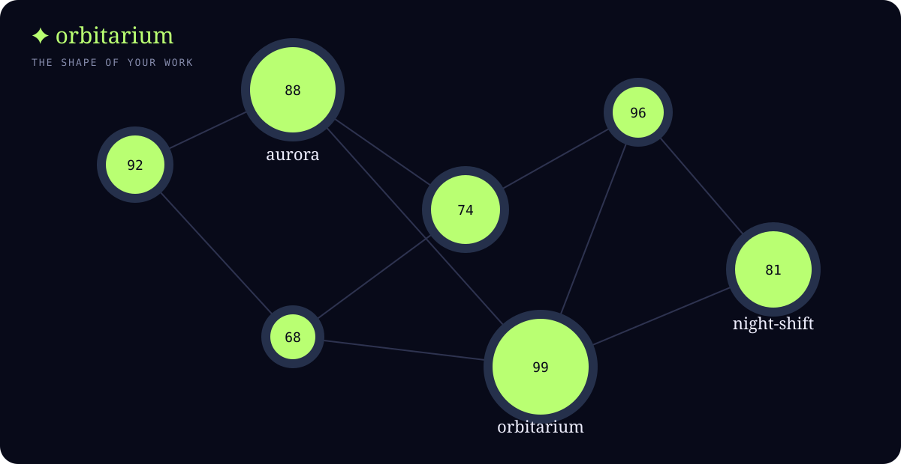

# ✦ Orbitarium

> The shape of your work.

Orbitarium is a local-first developer observatory. It maps the Git repositories on your machine into a living constellation: activity becomes signal, project size becomes mass, shared languages become bridges, and missing documentation becomes visible weather.

It is designed to feel like a desktop instrument, not another dashboard. Click a world to inspect it, rewind the horizon to see how its signal changes, open Mission Control for a gentle attention queue, or leave the sky moving while you work.



## Why it is different

- **Local by default.** Orbitarium reads repository metadata on your machine and serves the viewer to `127.0.0.1`. It has no telemetry service, account, or cloud dependency.
- **Useful at a glance.** One screen gives you a memorable overview of activity, health, languages, documentation, and relationships.
- **Respectfully interpretive.** “Weather” and “signal” are visual metaphors backed by documented, deterministic heuristics—not claims about your productivity or your code quality.
- **Easy to remix.** The scanner emits plain JSON and the viewer is dependency-free HTML, CSS, SVG, and browser JavaScript.
- **Friendly to a real desktop.** Watch one workspace or every mounted Windows drive and let the constellation refresh while you work.

## Quick start

Requires Node.js 20 or newer.

```powershell
git clone https://github.com/grubbs-dev/orbitarium.git
cd orbitarium
npm install
npm run demo
npm start
```

Open [http://127.0.0.1:4317](http://127.0.0.1:4317). The demo is synthetic, safe, and immediate—you can explore the whole interface without giving Orbitarium access to anything outside the repository.

## Map your own repositories

```powershell
npm run scan -- --root V:\Development\Repos --out reports\repos.json
npm run serve -- --report reports\repos.json
```

On Windows, scan every mounted local drive and keep the report fresh:

```powershell
npm run serve -- --report reports\live.json --watch-all-drives --watch-interval 30000
```

The live mode is opt-in. It only scans directories that contain a `.git` folder, skips common dependency/build directories, and writes the report to the path you choose. Reports are ignored by Git so local machine details do not accidentally enter a commit.

## Explore the sky

| Control | What it does |
| --- | --- |
| **Constellation** | The original radial map of your repositories and shared-language bridges. |
| **Signal radar** | Pulls aging or fragile projects toward the edge of a weather radar. |
| **Orbital drift** | Gives each world a slow, ambient orbit. |
| **Horizon** | Rewinds the forecast up to one year. |
| **Mission Control** | Surfaces the lowest signals and the language families connecting your work. |
| **Live** | Reloads the report when the watched server produces a newer scan. |
| **Focus mode** | Removes the instrument chrome for an ambient desktop view. |

Keyboard shortcuts: `/` search, `p` pulse, `m` Mission Control, and `f` focus mode. Stars are keyboard-focusable as well as clickable.

## What is collected

Orbitarium records repository-level metadata: name, path relative to the selected root, current branch, commit count, latest commit age, file count, byte size, detected languages, common manifests, README presence, and a derived health score. It does not upload data, read file contents broadly, or inspect source text. The scanner only samples well-known manifest files and file extensions.

For commercial use, review the privacy and deployment behavior of any wrapper or host application you build around Orbitarium. The core project is intentionally local-only, but your deployment choices are your responsibility.

## Development

```powershell
npm test
npm run check
node src/cli.js scan --root . --out reports\self.json
```

The project has no runtime dependencies. Tests cover language classification, health scoring, deterministic graph layout, report generation, mission-control insights, and the static server contract.

See [CONTRIBUTING.md](CONTRIBUTING.md) for the contribution workflow and [SECURITY.md](SECURITY.md) for responsible disclosure.

## License

Orbitarium is released under the [MIT License](LICENSE). See the license text for the complete terms.

Made for people who like seeing their tools become a place.
